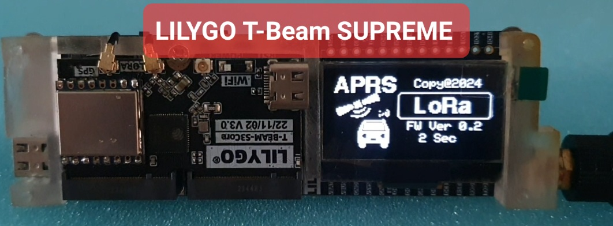
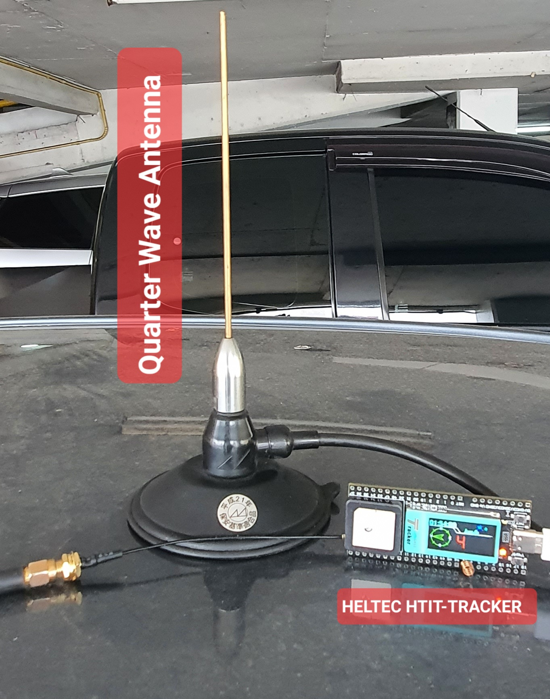
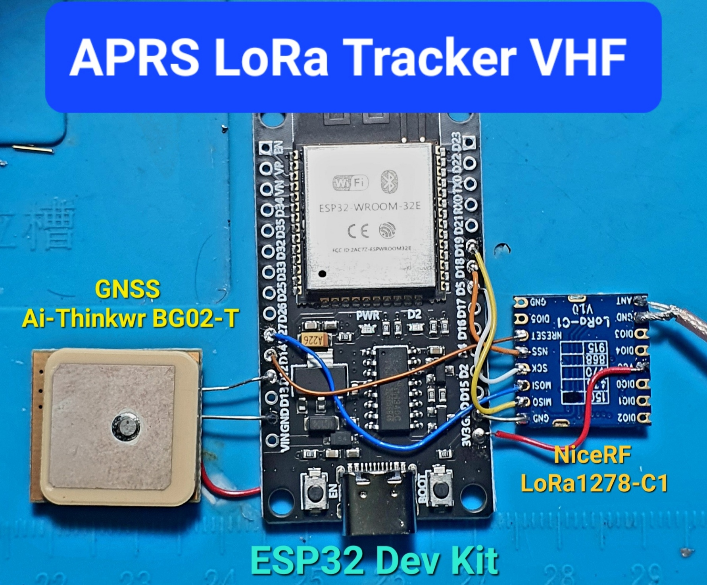
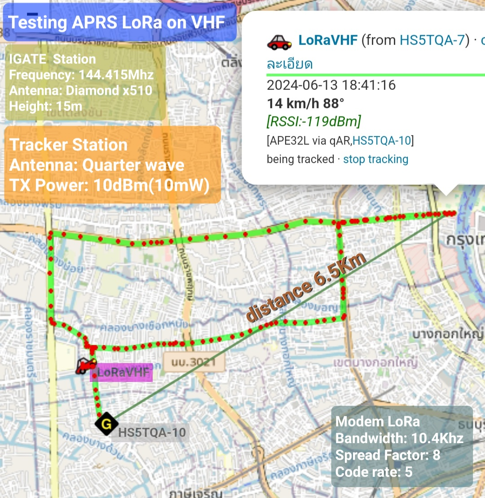
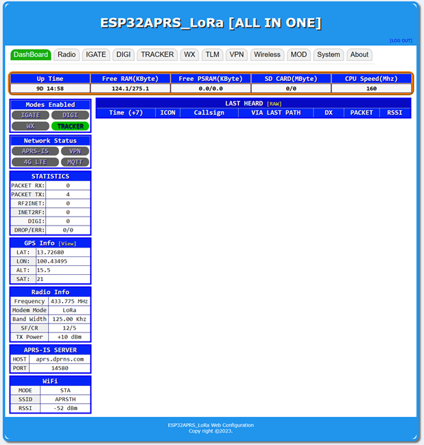
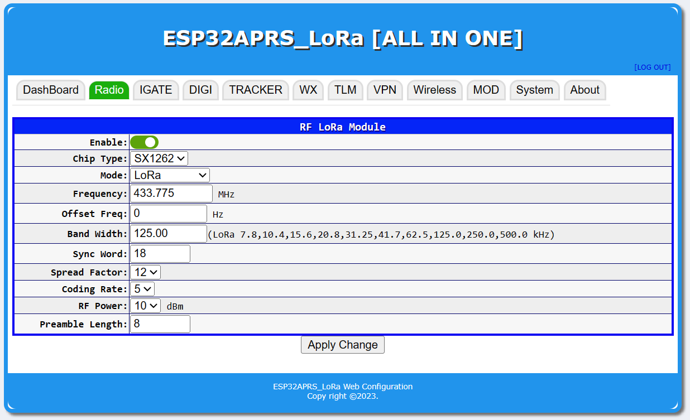
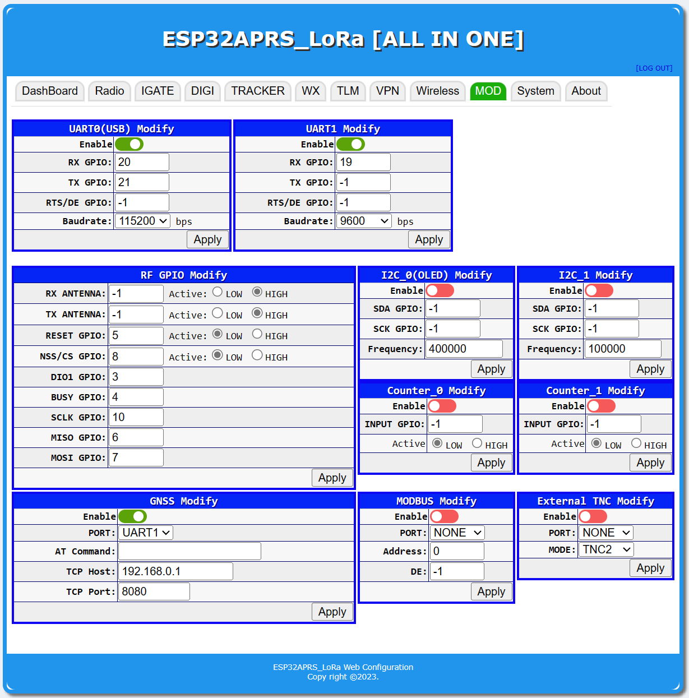

# Arduino core for the ESP32, ESP32-C3, ESP32-C6 and ESP32-S3.

# ESP32APRS LoRa Simple Project

ESP32APRS_LoRa is a Internet Gateway(IGate)/Dital Repeater(DiGi)/Tracker/Weather(WX)/Telemetry(TLM) with LoRa RF network in that is implemented for Espressif ESP32,ESP32-S3,ESP32C3 processor support.
 

## Feature
* Support (G)FSK Modem for D.I.Y
* Support GFSK9600(G3RUH) Modem for APRS(Test by Direwolf,VX8-DR,FTM-350,FTM-400DR TX Delay 100mS)
* Support AIS (Automatic Identification System) RX Only, IGate by APRS-CB recommend.
* Support APRS on AX.25 Protocol
* Support hardware: TTGO_LoRa32_V1,TTGO LoRa32(T3) V1.6,TTGO T-Beam V1.2,LILYGO T-Beam-S3 Supreme,T-Beam-S3 BPF,Heltec HTIT-Tracker,HT-CT62, Heltec LoRa V3 GPS,ESP32-Devkit and D.I.Y Mod GPIO
* Support APRS internet gateway (IGATE)
* Support APRS digital repeater (DIGI)
* Support APRS tracker (TRACKER)
* Support APRS Weather (WX)
* Support APRS telemetry (TLM)
* Support APRS Message (MSG)
* Support GNSS External mod select UART0-2 and TCP Client
* Support TNC External mod select UART0-2 and Yaesu packet
* Support APRS IGATE/DIGI/WX with fix position for move position from GNSS
* Using ESP-Arduino development on Visual studio code + Platform IO
* Support LoRa Chip SX1261,SX1262,SX1268,SX1273,SX1273,SX1276,SX1278,SX1279,SX1280,SX1281,SX1282
* Support Frequncy by LoRa Chip 137Mhz-1020Mhz
* Support monitor display information and statistices
* Support Wi-Fi multi station or WiFi Access point
* support Web Service config and control system
* support filter packet rx/tx on igate,digi,display
* support VPN wireguard
* support global time zone
* support PCF85063 RTC on the PMU I2C bus (NAWS4) to keep time between power cycles; the RTC is loaded at boot and updated from NTP/GPS
* support web service auth login
* support BLUETOOTH SPP/BLE
* support PPPoS (PPP Over Serial GSM network)
* support MQTT
* support AT-Command config/ctl by channel UART,MSG,Bluetooth
* support Telemetry on IGate,Digi,Tracker
* support Automatic REBOOT by interval time
* display received and transmit packet on the LED and display OLED

## Hardware screen short
   

## Web service screen short

  \


## WIKI How to install firmware
* [How to install firmware for TTGO LoRa32 V1.0](https://github.com/nakhonthai/ESP32APRS_LoRa/wiki/How-to-install-firmware-for-TTGO-LoRa32-V1.0)
* [How to install firmware for LILYGO T‐Beam SUPREME (M)](https://github.com/nakhonthai/ESP32APRS_LoRa/wiki/How-to-install-firmware-for-LILYGO-T%E2%80%90Beam-SUPREME-(M))
* [How to install firmware for HELTEC HTIT‐Tracker](https://github.com/nakhonthai/ESP32APRS_LoRa/wiki/How-to-install-firmware-for-HELTEC-HTIT%E2%80%90Tracker)
* [How to install firmware for ESP32‐DevKit,DI](https://github.com/nakhonthai/ESP32APRS_LoRa/wiki/How-to-install-firmware-for-ESP32%E2%80%90DevKit,DIY)

## WIKI How to configuration
* [How to config WX:Weather Station Report](https://github.com/nakhonthai/ESP32APRS_LoRa/wiki/How-to-config-WX:Weather-Station-Report)
* [How to config Telemetry on IGate Digi Tracker](https://github.com/nakhonthai/ESP32APRS_LoRa/wiki/How-to-config-Telemetry-on-IGate-Digi-Tracker)


## PlatformIO Quick Start

1. Install [Visual Studio Code](https://code.visualstudio.com/) and [Python](https://www.python.org/)
2. Search for the `PlatformIO` plugin in the `VisualStudioCode` extension and install it.
3. After the installation is complete, you need to restart `VisualStudioCode`
4. After restarting `VisualStudioCode`, select `File` in the upper left corner of `VisualStudioCode` -> `Open Folder` -> select the `ESP32APRS_LoRa` directory
5. Click on the `platformio.ini` file, and in the `platformio` column, cancel the sample line that needs to be used, please make sure that only one line is valid and change ESP type HT-CT62 Module as `default_envs = ht-ct62` or TTGO LoRa32 V1 as `default_envs = ttgo-lora32-v1`
6. Click the (✔) symbol in the lower left corner to compile
7. Connect the board to the computer USB
8. Click (→) to upload firmware and reboot again
9. After reboot display monitor and reconfig

## RAM usage (internal memory / heap)

Boards built with `-DBOARD_HAS_PSRAM` keep large runtime buffers in PSRAM so
that the internal RAM stays available for the network stack, WiFi/LWIP and TLS:

* packet queues (`pkgList`, `Telemetry`, `txQueue`, `msgQueue`) are allocated
  with `ps_malloc()` at boot,
* every generated web page uses `allocateStringMemory()`, which allocates from
  PSRAM and only falls back to the internal heap when PSRAM is exhausted,
* the 24-hour rain history (`weather.cpp`, 1440 entries) is allocated on demand
  in PSRAM instead of living in `.bss`.

If a PSRAM allocation fails, all of the above fall back to the internal heap
instead of dereferencing a NULL pointer.

Note: task stacks stay in internal RAM on purpose. A task whose stack lives in
PSRAM may not run while the flash cache is disabled (config/LittleFS/OTA
writes), which would make those operations unsafe.

## PPP (4G/LTE modem) teardown fix

`lib/PPP` is a local copy of the Arduino core `PPP` library. In the Arduino
core 3.1.x release `PPPClass::end()` destroys the `esp_netif` **before**
calling `esp_modem_destroy()`. When PPP is restarted at runtime (for example
after `taskNetwork()` reports `PPP Ping Fail!`), a `NETIF_PPP_STATUS` event
posted from the modem task can arrive with the already freed netif and the
firmware aborts with:

```
assert failed: on_ppp_notify_phase esp_netif_lwip_ppp.c:158
(obj->base.netif_type == PPP_LWIP_NETIF)
```

The local copy keeps the upstream order (`esp_modem_destroy()` first), so a
PPP restart no longer crashes. `PPPOS_Start()` additionally enforces a 30
second minimum interval between restarts so the modem and the event task have
time to settle. Keep `lib/PPP` until the core version you build against ships
the fixed ordering.

## Reducing firmware size (optional)

The firmware is built with `-Os`, `-ffunction-sections`, `-fdata-sections` and
`-Wl,--gc-sections`, so unused code is already removed. If you need more free
flash (for example on 4MB boards that keep two OTA partitions), the following
optional build flags can be added to an environment in `platformio.ini`:

| Build flag / change | Approx. saving on ESP32-C3 | What is removed |
|---|---|---|
| `-DNO_WIREGUARD` | 70KB+ | WireGuard VPN client (`esp_wireguard` + libsodium) and its web page |
| remove `-DPPPOS` | 46KB | PPP over serial (GSM/4G modem) support and `esp_modem` |
| One radio family only | up to 30KB | Unused RadioLib SX126x/SX127x/SX128x drivers |

The `ht-ct62` environment already sets `-DNO_WIREGUARD`. OTA-by-URL and the
remote version check use a small built-in HTTP GET client, therefore only
`http://` URLs are supported (HTTPS is not available in these trimmed builds).

## APRS Server service

- APRS SERVER of T2THAI at [aprs.dprns.com:14580](http://aprs.dprns.com:14501), CBAPRS at [aprs.dprns.com:24580](http://aprs.dprns.com:24501)
- APRS SERVER of T2THAI ampr host at [aprs.hs5tqa.ampr.org:14580](http://aprs.hs5tqa.ampr.org:14501)
- APRS MAP SERVICE [http://aprs.dprns.com](http://aprs.dprns.com)

## Developer/Support Information

- Author:	Mr.Somkiat Nakhonthai
- Callsign:	HS5TQA,Atten,Nakhonthai
- Country:	Bangkok,Thailand
- Github:	[https://github.com/nakhonthai](https://github.com/nakhonthai)
- Youtube:	[https://www.youtube.com/@HS5TQA](https://www.youtube.com/@HS5TQA)
- TikTok:   [https://www.tiktok.com/@hs5tqa](https://www.tiktok.com/@hs5tqa)
- Facebook:	[https://www.facebook.com/atten](https://www.facebook.com/atten)
- Telegram: [https://t.me/APRSTH](https://t.me/APRSTH)
- TelegramID: @HS5TQA
- WeChatID: HS5TQA

## Donate

To support the development of ESP32APRS you can make us a donation using [github sponsors](https://github.com/sponsors/nakhonthai). \
If you want to donate some hardware to facilitate APRS porting and development, [contact us](https://www.facebook.com/atten). \
<a href="https://www.paypal.me/0hs5tqa0"></a> 

## ESP32 Flash Download Tools
https://www.espressif.com/en/support/download/other-tools

## Credits & Reference

- Thank you for support device hardware (LiLyGo T-Beam-S3 Supreme,T-Beam-S3 BPF,HTIT-Tracker,NiceRF Module) by Mr.Chakphanu [E24OUW](https://github.com/chakphanu)
- Thank you for all library from github

## HITH
This project implement by APRS text (TNC2 Raw) only,It not support null string(0x00) in the package.
